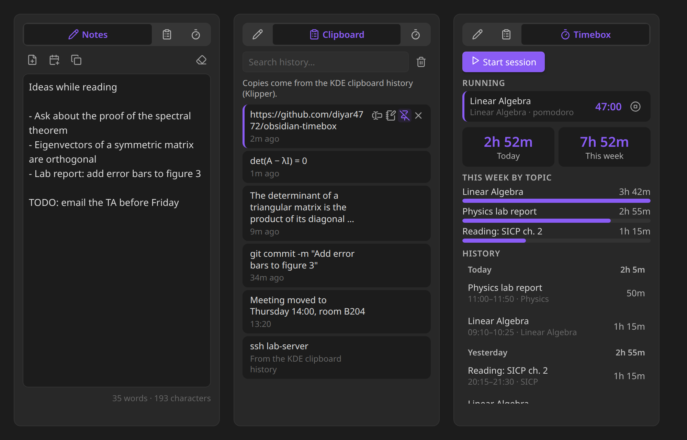
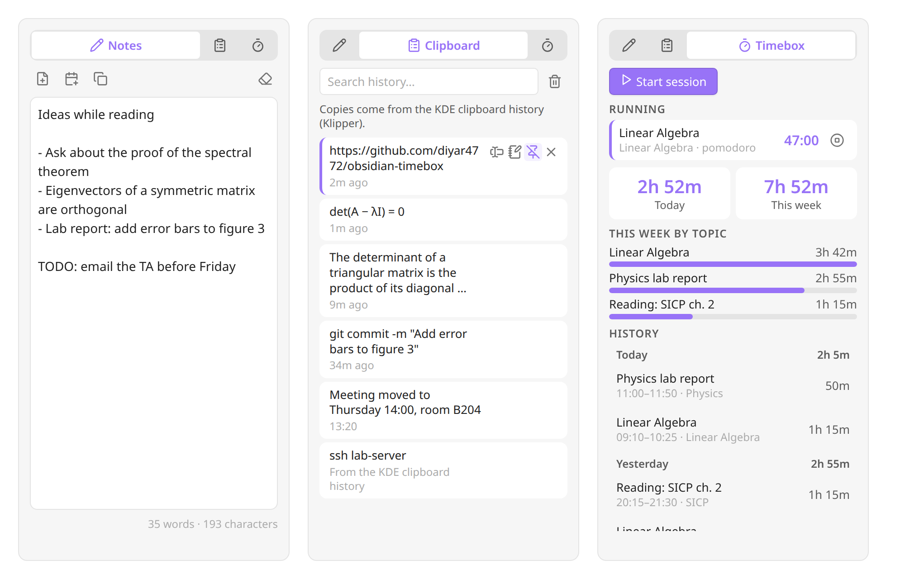
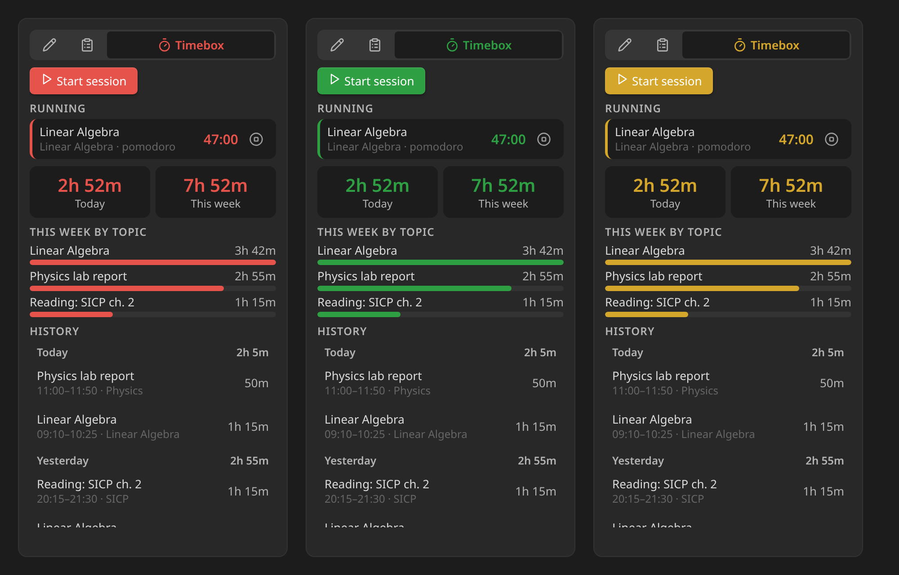

# Notepad

A small, tabbed panel for Obsidian's sidebar: a **scratch page** for quick thoughts, your **clipboard history**, and your **Timebox** sessions. It sits under the Calendar, in the space that is usually empty.

[](https://github.com/diyar4772/obsidian-notepad/releases/latest)
[](https://obsidian.md/plugins?id=notepad)



## Installation

In Obsidian, open **Settings → Community plugins → Browse**, search for **Notepad** and select **Install**, then **Enable**.

The panel opens under the Calendar view in the right sidebar (or in its own spot in the right sidebar if Calendar isn't installed). Drag it anywhere you like. To bring it back after closing it, use the notebook icon in the left ribbon or the **Notepad: Open** command.

## Notes

A scratch page for things you want to keep in mind while you're busy with something else. It saves itself as you type and is still there after a restart.

- **Save as note** turns it into a note (in a folder you choose).
- **Add to today's daily note** appends it to the daily note the Calendar plugin opens, and creates that note from your template if it doesn't exist yet.
- **Copy** and **Clear** (click twice, so nothing is lost by accident).
- Select text in any note and choose **Add to notepad** from the right-click menu to collect it here.

## Clipboard

A history of the text you copy, newest first.

- Click an entry to copy it again.
- Insert it at the cursor in your note, add it to the scratch page, **pin** it to keep it at the top (pinned entries are never removed), or remove it.
- Search the history.

On Windows and macOS every copy is recorded while Obsidian is running, in any app. On mobile, copies made inside Obsidian are recorded.

### KDE Plasma: the full clipboard history

On KDE Plasma, Notepad reads the history of **Klipper**, the clipboard in the system tray (<kbd>Meta</kbd>+<kbd>V</kbd>). Klipper sees every copy, even while Obsidian is in the background, so:

- copies you make in other apps show up right away, also on Wayland;
- when Obsidian starts, copies you made while it was closed are added. Their copy time isn't known, so they're marked *From the KDE clipboard history*. The very first time, Klipper's whole history comes in.

Klipper itself leaves out copies that password managers mark as secret. Notepad uses Klipper automatically when it's running; turn this off with **Use the KDE clipboard history** in the settings.

**Obsidian from Flathub (Flatpak):** the sandbox has to be allowed to talk to Klipper. Run this once in a terminal, then restart Obsidian:

```bash
flatpak override --user --talk-name=org.kde.klipper md.obsidian.Obsidian
```

Notepad can't do this for you: an app inside the Flatpak sandbox can't change its own permissions, so this one step is yours. The Clipboard tab shows the command when it's needed. To take the permission back later, run `flatpak override --user --no-talk-name=org.kde.klipper md.obsidian.Obsidian`.

### Linux without Klipper

On a Wayland session without Klipper (for example GNOME), Obsidian only sees the clipboard while its window is focused: copies made in other apps in the meantime aren't seen one by one, and only the last one is recorded when you switch back. Copies made inside Obsidian are always recorded. Linux on X11 doesn't have this limit.

## Timebox

[Timebox](https://github.com/diyar4772/obsidian-timebox) is a companion plugin: it tracks study and work sessions inside your notes. When you start a session, a `timebox` block with the topic and start time goes into the note; when you finish, the end time and duration are written into it. It has an optional pomodoro cycle with alerts.

Notepad's Timebox tab gives those sessions a home in the sidebar:

- **Running sessions** with a live timer and a stop button. Stopping goes through Timebox, so the block in your note is updated exactly as if you had clicked Finish there.
- **Start session** starts one in the note you were last working in, with Timebox's own command.
- **Today** and **This week** totals, counting up while a session runs.
- **This week by topic**: where your time went.
- **History**: finished sessions of the last days, grouped by day with daily totals. Click one to jump to its block.

Notepad reads the sessions with Timebox's own parser, so both plugins always agree on what counts as a session, and it never changes the blocks itself. Without Timebox, the tab says so and the other tabs work on their own.

## Colors and themes

Notepad follows your theme, light or dark. If you like, pick your own accent, background and text colors in the settings; reset any of them to go back to the theme's.





## Settings

- **Tabs:** show or hide each tab. With a single tab, the tab bar disappears.
- **Notes:** save folder, open the note after saving, clear the page after saving, font size.
- **Clipboard:** record on or off, history size (pinned entries don't count), how often the clipboard is checked, and on Linux, use the KDE clipboard history.
- **Timebox:** how many days of history to list.
- **Colors:** accent, background and text color.

Every setting can be found with Obsidian's settings search.

## Commands

- **Open**
- **Show notes tab**, **Show clipboard tab**, **Show timebox tab**
- **Add selection to scratch page** (also in the editor's right-click menu as *Add to notepad*)

None of them has a default hotkey; assign your own under **Settings → Hotkeys**.

## Works with your other plugins

- **Timebox:** see [Timebox](#timebox).
- **Calendar and Daily notes:** *Add to today's daily note* uses the folder, date format and template of the Daily notes core plugin, so it lands in the note Calendar opens. A new daily note gets its template with `{{date}}`, `{{time}}`, `{{title}}`, `{{yesterday}}`, `{{tomorrow}}` and `{{date:FORMAT}}` filled in, like the core plugin does.
- **Your own plugins and scripts:** `app.plugins.plugins.notepad.api` offers `appendToScratch(text)`, `getScratch()` and `getClipboardHistory()`.

## Privacy and permissions

Notepad makes no network requests. Everything it keeps is in the plugin's `data.json` inside your vault (`.obsidian/plugins/notepad/`).

- **Clipboard:** on desktop Notepad reads the system clipboard to build the history, and writes to it when you copy an entry back. Copies that a password manager marks as secret (KeePassXC, Bitwarden, 1Password and others that use the standard hint on Windows, macOS and Linux) aren't recorded, and neither are copies longer than 100,000 characters. The history is stored as plain text, so if your vault is synced, the history travels with it. Turn recording off or clear the history if that matters to you.
- **KDE clipboard history:** on Linux, Notepad runs the `gdbus` command line tool to read Klipper's history over D-Bus and to listen for its changes. Nothing else is run.
- **Reading your notes:** to find Timebox sessions, the Timebox tab reads your notes once, the first time you open it, and then only re-reads notes that change.
- **Writing:** Notepad only creates or changes notes when you ask it to (save as note, add to daily note, insert into note).

## Requirements

Obsidian 1.13 or newer, on desktop or mobile. On older versions of Obsidian, version 1.0.1 of Notepad is installed instead.

## Development

```bash
npm install
npm run dev    # watch build
npm test       # core and plugin tests
npm run build  # type check + production build
```

Developer notes are in [CLAUDE.md](CLAUDE.md).

## License

[MIT](LICENSE) © Samed Yolcu
